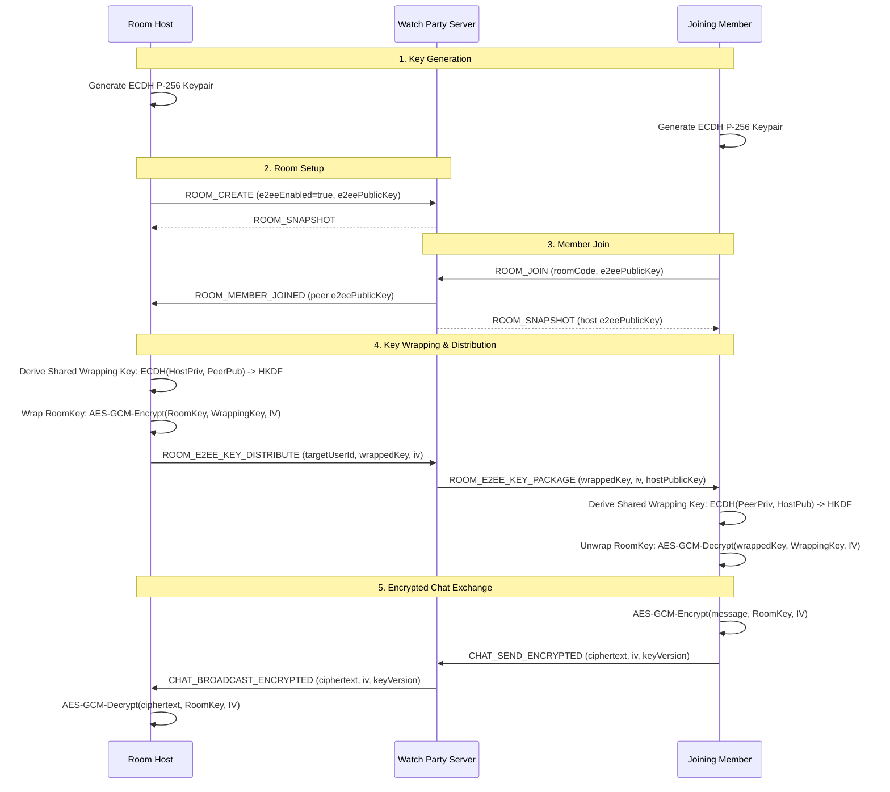

# Security Policy and Threat Model

Watch Party is a synchronized video playback and real-time social platform designed with defense-in-depth principles. This document provides a transparent and rigorous breakdown of our security posture, threat model, cryptographic architecture, operational safeguards, and key rotation procedures.

---

## 1. Threat Model & Risk Assessment

### 1.1 Protected Assets
| Asset | Confidentiality | Integrity | Availability | Storage & Protection Mechanism |
| :--- | :--- | :--- | :--- | :--- |
| **User Passwords** | Critical | Critical | High | Salted Argon2id (`$argon2id$v=19$m=65536,t=3,p=4`), memory-hard, common password blacklist rejection. |
| **Refresh Tokens** | Critical | Critical | High | SHA-256 hashed at rest; stored in `httpOnly, Secure, SameSite=Lax` cookies; rotating family with automatic reuse breach revocation. |
| **User PII & Email Tokens** | High | High | High | AES-256-GCM authenticated field encryption at rest with versioned headers (`v1:iv:tag:cipher`) and zero-downtime fallback rotation. |
| **E2EE Room Chat** | Critical | Critical | High | Client-side WebCrypto ECDH (P-256) + HKDF + AES-GCM-256. Server only relays ciphertext; room keys rotated on member departure/kick. |
| **Room Playback & Clock Sync** | Low | High | Critical | High-frequency monotonic clock timestamps, fractional playlist ordering, and authoritative sequence verification. |
| **Audit Logs** | High | Critical | High | Append-only structured JSON security audit records with actor/target attribution and request IDs (`X-Request-Id`). |

---

### 1.2 Adversary Profiles & Attack Vectors

#### Attacker 1: Network Eavesdropper & Man-in-the-Middle (MITM)
- **Capabilities**: Intercepts, modifies, or replays traffic between client and server on public Wi-Fi or compromised ISPs.
- **Mitigations**:
  - Strict HTTPS and WSS enforced everywhere with HSTS (`max-age=31536000; includeSubDomains; preload`).
  - Preflight TLS termination with forward-secret cipher suites.
  - WebCrypto E2EE with out-of-band 30-digit human-verifiable safety fingerprint (`XXXXX XXXXX XXXXX XXXXX XXXXX XXXXX`).

#### Attacker 2: Honest-but-Curious / Compromised Server
- **Capabilities**: Inspects internal memory, database dumps, and server logs.
- **Mitigations**:
  - Server never possesses or generates E2EE room keys.
  - Server only relays ciphertext packages between members.
  - Server database stores sensitive fields encrypted with AES-256-GCM using keys stored outside the database.
  - Passwords and refresh tokens are strictly stored hashed (one-way).

#### Attacker 3: Malicious Room Member / Late Joiner
- **Capabilities**: Joins a public or shared room, attempts unauthorized host commands (IDOR), seeks or buffers maliciously, or tries reading past chat before joining.
- **Mitigations**:
  - **Host-Only Authorization**: Commands such as kicking, host promotion, and restricted playback control require verified host privileges. Non-host attempts are rejected with `PERMISSION_DENIED`.
  - **Forward Secrecy & Key Rotation**: Room key rotates immediately when any member leaves, is kicked, or host changes. New members only receive the current key version; server snapshot omits or filters out prior chat history before their join timestamp.
  - **Deterministic Rate Limiting**: Token-bucket throttling per connection (max 30 burst, 10/sec refill) stops command floods.

#### Attacker 4: Cross-Origin Web Attacker (CSRF, Clickjacking, XSS)
- **Capabilities**: Hosts an untrusted website attempting to forge authenticated requests or embed Watch Party in an iframe.
- **Mitigations**:
  - **Strict CORS Allowlist**: Only explicitly whitelisted origins receive `Access-Control-Allow-Origin` with `Access-Control-Allow-Credentials: true`. Wildcards (`*`) with credentials are completely forbidden.
  - **Anti-CSRF Custom Headers**: State-modifying requests (`POST`, `PUT`, `DELETE`) authenticated via cookies require custom headers (`X-Requested-With`, `X-CSRF-Token`, or `X-WatchParty-Client`), which cross-origin web forms cannot forge.
  - **Frame Protection**: `X-Frame-Options: DENY` and CSP `frame-ancestors 'none'` prevent clickjacking.
  - **Content Security Policy (CSP)**: `default-src 'self'; script-src 'self'; object-src 'none'; frame-ancestors 'none'`.

#### Attacker 5: Prototype Pollution & Malformed Input DoS
- **Capabilities**: Sends malicious JSON containing `__proto__`, `constructor`, or oversized payloads over WebSocket.
- **Mitigations**:
  - **64KB WebSocket Frame Limit**: Sockets exceeding 64KB are instantly terminated with WebSocket close code `1009 (Message Too Big)`.
  - **Recursive Prototype Pollution Stripping**: `safeJsonParse` recursively purges `__proto__`, `constructor`, and `prototype` keys via reviver and property sanitization before schema parsing.
  - **Zod Strict Schemas**: Every incoming WebSocket message is validated against discriminated union schemas.
  - **HTML Entity Sanitization**: `sanitizeText` escapes `<`, `>`, `&`, `"`, `'`, and `/` against raw HTML injection.

---

### 1.3 Transparent Cryptographic Boundary & Sync Tradeoff

> [!IMPORTANT]
> **What Is and Is NOT Encrypted in E2EE Rooms**
> - **ENCRYPTED**: Room chat messages, including message content, user text, and attachments, are end-to-end encrypted using client-side WebCrypto AES-GCM-256. The server only sees base64 ciphertext and 12-byte initialization vectors (IVs).
> - **NOT ENCRYPTED**: Playback commands (`PLAYBACK_PLAY`, `PLAYBACK_PAUSE`, `PLAYBACK_SEEK`, `SYNC_PING`, buffer reports, playlist additions, and participant metadata) remain plaintext to the server.
> 
> **Rationale & Threat Model**:
> Synchronized video playback relies on the server acting as an authoritative monotonic clock sequencer, measuring NTP round-trip times (RTT), running drift correction algorithms, and orchestrating buffer stalls across up to 50 concurrent viewers. Encrypting playback timestamps would require complex multi-party computation (MPC) that introduces high network latency, violating our **p95 <= 250ms latency** and **drift <= 500ms** sync guarantees.

---

## 2. End-to-End Encryption (E2EE) Protocol Specification

Watch Party implements an optional per-room E2EE mode using the standard native **WebCrypto API** (`globalThis.crypto.subtle`), requiring no third-party cryptography binaries.

### 2.1 Cryptographic Primitives
1. **Member Identity & Key Agreement**: Ephemeral Elliptic-Curve Diffie-Hellman (ECDH) on the NIST **P-256** (secp256r1) curve.
2. **Key Derivation (KDF)**: HKDF-SHA-256 with 32-byte zero salt and info string `"watchparty-e2ee-room-key-v1"` derives a 256-bit AES-GCM wrapping key.
3. **Room Key Encryption**: 256-bit AES-GCM room key wrapped with a 12-byte random IV.
4. **Message Encryption**: AES-GCM-256 with a unique 12-byte random IV per message.

### 2.2 Key Distribution Flow



### 2.3 Key Rotation & Forward Secrecy
The room key is rotated (`keyVersion++`) under three mandatory conditions:
1. **Member Left**: A peer disconnects or leaves the room.
2. **Member Kicked**: The host removes a participant.
3. **Host Transfer**: Ownership transfers manually or through automatic promotion.

When rotation triggers:
- Server broadcasts `ROOM_E2EE_KEY_ROTATED`.
- Host immediately generates a fresh random 256-bit AES-GCM key.
- Host wraps the new key for all remaining members and distributes packages.
- Former members lack the new key and cannot decrypt subsequent communications.
- Messages encrypted with past key versions display `[Encrypted Message - Previous Key Version]`.

---

## 3. Human-Verifiable Safety Fingerprint

To protect against Man-in-the-Middle attacks where an attacker swaps public keys, members can verify a deterministic **Safety Code**:

$$\text{Seed} = \text{RoomId} \mathbin{\Vert} \text{Sort}(\text{PublicKey}_1, \text{PublicKey}_2, \dots)$$
$$\text{Digest} = \text{SHA-256}(\text{Seed})$$

The digest bytes are converted into **30 decimal digits** formatted in 6 blocks of 5 digits:
```text
38291 94820 18274 58291 03847 29184
```
Members compare this fingerprint out-of-band (e.g. voice call, signal) to verify cryptographic authenticity.

---

## 4. Key Rotation Runbook (Field-Level Encryption at Rest)

The `FieldEncryption` service encrypts sensitive tokens and PII using AES-256-GCM. To rotate keys in production without downtime:

1. **Generate New Primary Key**:
   ```bash
   openssl rand -hex 32
   # Output: a1b2c3d4e5f6... (64 hex characters)
   ```
2. **Update Environment Variables**:
   Move current `ENCRYPTION_KEY` into `ENCRYPTION_KEY_FALLBACKS`, and set the new key:
   ```env
   ENCRYPTION_KEY=new_64_character_hex_key_here
   ENCRYPTION_KEY_FALLBACKS=old_64_character_hex_key_here
   ```
3. **Deploy Application**:
   Restart server instances. The service decrypts legacy records with fallback keys and writes all new records with the primary key.
4. **Trigger Background Re-Encryption (Optional)**:
   Call `fieldEncryption.rotate(record)` or run a database migration to re-encrypt existing records.
5. **Retire Old Key**:
   Once all legacy rows are updated, remove the old key from `ENCRYPTION_KEY_FALLBACKS`.

---

## 5. Security Audit Logging

All security-sensitive operations generate structured audit log entries:
- `AUTH_LOGIN_SUCCESS` / `AUTH_LOGIN_FAILED`
- `AUTH_PASSWORD_RESET_REQUESTED` / `AUTH_PASSWORD_RESET_SUCCESS`
- `AUTH_ACCOUNT_LOCKED`
- `ROOM_CREATED`
- `ROOM_HOST_TRANSFERRED`
- `ROOM_MEMBER_KICKED`
- `FRIEND_BLOCKED`
- `E2EE_KEY_ROTATED`

Each log record contains `id`, ISO 8601 `timestamp`, `type`, `actorId`, `targetId`, `outcome`, and contextual `details`.

---

## 6. Vulnerability Disclosure & Reporting

If you discover a security vulnerability in Watch Party, please do not file a public GitHub issue. Send a confidential report to `security@watchparty.example.com` including:
1. Description of the vulnerability and affected component.
2. Step-by-step proof-of-concept (PoC) or script.
3. Impact assessment.

We respond to security disclosures within 24 hours and provide coordinated public disclosure after mitigation.
